# omarchyvr: Pimax Dream Air VR on Linux (Omarchy / Arch)

[Support the project on Ko-fi](https://ko-fi.com/josemauriciocarpioherrera) · [Follow on X](https://x.com/carpio_her8717)

**Unofficial community project.** It is not made, endorsed or supported by Pimax or Omarchy. "Pimax" and "Dream Air" are trademarks of Pimax, used only to say which hardware this works with. There is no warranty: the tools talk to the headset over USB and change system settings, so use them at your own risk. Code is MIT OR Apache-2.0, docs and data are CC-BY-4.0 (see [NOTICE](NOTICE) and [THIRD-PARTY.md](THIRD-PARTY.md)).

omarchyvr makes the **Pimax Dream Air** work on Linux (Arch / Omarchy, Hyprland) the way Pimax Play does on Windows: **one app, one click.** Pimax has no Linux support, so everything here was reverse-engineered from USB captures of our own headset on Windows, then rebuilt in Rust, in a Monado fork and in a WayVR fork.

**Status: alpha, one tested setup** (see [Our machine](#our-machine)). Expect rough edges on anything else.

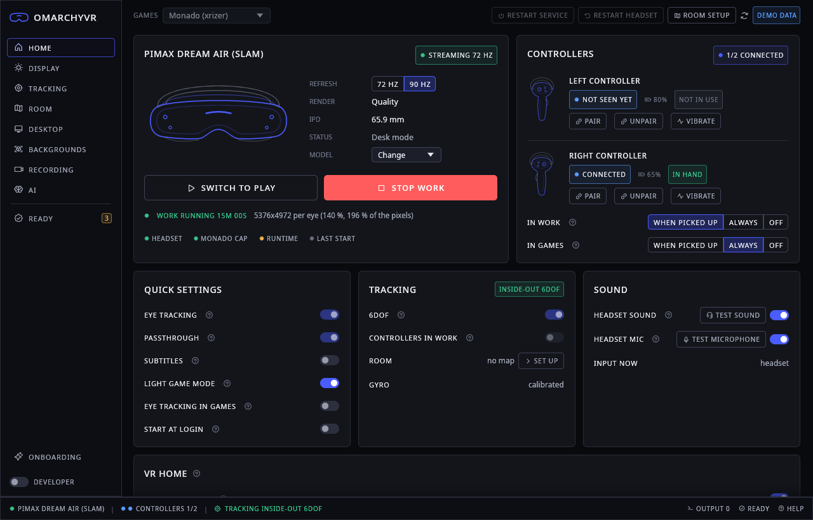

Everything is in the app (`omarchyvr-app`, starts at login). **Play** starts VR games (SteamVR or Monado + xrizer), **Work** starts the VR desk (your Hyprland desktop on up to six screens around you). No terminal after the install.

## Contents

- [Install](#install)
- [What we have done](#what-we-have-done)
- [What works today](#what-works-today)
- [Architecture](#architecture)
- [The app](#the-app)
- [Our machine](#our-machine)
- [What comes next](#what-comes-next)
- [Known problems](#known-problems)
- [Docs](#docs) · [Safety](#safety) · [Report a bug](#report-a-bug) · [Credits](#credits-and-licences) · [Developers](#for-developers)

## Install

### Requirements

| | Needed |
|---|---|
| Headset | Pimax Dream Air (USB `34a4:0044`). Other Pimax models are detected but not supported. |
| System | Arch Linux or Omarchy with Hyprland (other Arch-based setups are untested) |
| GPU | NVIDIA RTX with `nvidia-open-dkms`. Only **610.57.04** is tested ([why](docs/NVIDIA-UNTESTED.md)) |
| Games | Steam with SteamVR, installed by you |
| Disk | about 40 GB free for the build; AI and voice models are downloaded later, only if you want them |

The full table (tested, experimental, unsupported) is in [docs/INSTALL.md](docs/INSTALL.md#requirements).

> **Before you install.** The setup changes your system, not only your home folder: it patches the NVIDIA open
> kernel module (DKMS) and installs pacman hooks that re-apply the patch after driver updates, adds an EDID override
> and rebuilds the initramfs, installs a udev rule for the headset, and sets `cap_sys_nice` on the Monado service.
> **Take a snapper snapshot first** (the setup takes one too when snapper has a `root` config).
> Known open issues: [docs/SECURITY-STATUS.md](docs/SECURITY-STATUS.md).

### Steps

    git clone --recursive https://github.com/laughtt/omarchyvr.git
    cd omarchyvr && ./install.sh

That is the only command. Everything after it happens in the app:

| # | Where | What happens | You do |
|---|---|---|---|
| 1 | terminal | `./install.sh` checks the PC and builds the whole set from source: Monado, WayVR, every Rust tool and the app (about 15-30 min, lowest priority, you can keep working). Then it opens the app. | nothing |
| 2 | app | **Which headset do you have?** and **Get the headset ready** (cables, power, live ticks). | Continue, Start setup |
| 3 | app | The system part runs as **one** password prompt (pkexec): udev rule, NVIDIA patch + DKMS build, EDID override + initramfs, realtime permission for Monado and SteamVR. | type your password once |
| 4 | app | **Restart now**, only if the NVIDIA module or the boot image changed. The app opens again at login and finishes its checks. | Restart now |
| 5 | app | **Room setup** (quick 30 s or full 3 min), then **Play** or **Work**. The first Work asks once about voice and AI. | Play |

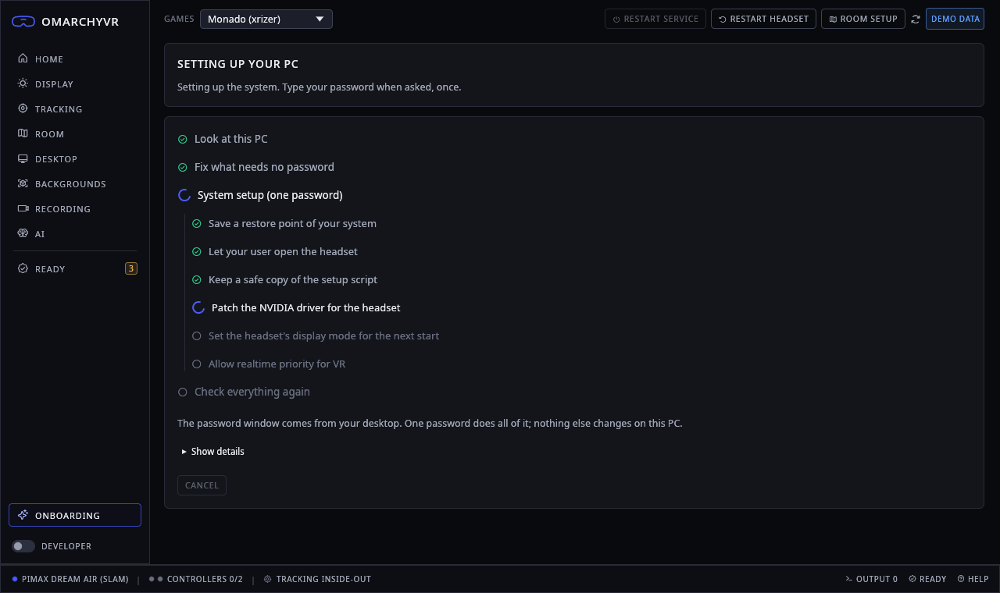

What the one password changes, line by line, with the undo for each: [docs/INSTALL.md](docs/INSTALL.md).

## What we have done

The Dream Air does not work on Linux out of the box: the desktop sees a dark DisplayPort screen with a broken EDID, the
NVIDIA driver shows the left half in both eyes or freezes, the headset stays asleep without its vendor service, and
there is no tracking, no controllers and no sound. This is how each part was made to work.

### 1. Listening to the headset (USB captures on Windows)
- We recorded Pimax Play talking to our own headset with USBPcap on Windows: cold start, power on, shutdown,
  tracking, pairing, IPD, restart, sound ([analysis/init-sequence.md](analysis/init-sequence.md),
  [analysis/poweron.md](analysis/poweron.md), [analysis/device-map.md](analysis/device-map.md)).
- Findings: the headset (`34a4:0044`) has four HID interfaces; everything that turns things on goes over **one command
  channel** (interface 0, `X` commands and `L` replies). The IMU streams at 500 Hz, the four infrared tracking cameras
  are a separate UVC device (`34a4:0014`), and the "dongle" (`34a4:0043`) is really the DisplayPort-to-panel bridge.
  Controllers stay paired in the headset radio; they need a 4-command attach per slot.
- **libpimax** (Rust, `rust/pimax-proto`, `rust/pimax`) speaks that protocol: wake, keepalive (the headset sleeps if
  interfaces 1-3 are not drained), panel on, IMU, controllers, haptics, IPD motor, brightness, a fast restart
  (back in about 8 s instead of a power cycle).
- **Only captured bytes are sent.** Every command is in an allowlist per headset
  (`rust/pimax-device/devices/dream-air/device.toml`, [docs/HEADSET-COMMANDS.md](docs/HEADSET-COMMANDS.md)). No firmware
  is ever flashed.

### 2. Getting a picture: EDID, DSC, DRM lease and the NVIDIA patches
- The stock EDID offers only 7104x3840 in a DisplayID block with "undefined" colour depth, so NVIDIA sends 18 bpp and
  the link fails its bandwidth check. Our **EDID override** (loaded from the initramfs) gives 8 bpc and the native
  72/90 Hz modes, with DSC and the HBR3 link ([linux/DISPLAY.md](linux/DISPLAY.md), [analysis/nvidia-dsc-linkrate.md](analysis/nvidia-dsc-linkrate.md)).
- A Microsoft HMD block in the same EDID marks the headset **non-desktop**: Hyprland keeps it off the desktop and
  **leases** it to Monado for direct mode ([analysis/edid-non-desktop.md](analysis/edid-non-desktop.md)).
- 7104x3840 needs NVIDIA's "2Heads1OR" mode (two display heads merged into one output). The open kernel module has
  bugs there, so we carry **three patches** for `nvidia-open-dkms` ([patches/nvidia](patches/nvidia/README.md)):
  - `nvidia-2h1or-viewport.patch`: both heads scanned the left half, so both eyes showed the left image
    (the fix of NVIDIA PR #1262, not yet in 610.57.04);
  - `nvidia-2h1or-flip-fix.patch`: the two merged heads could latch a flip on different frames and the display
    engine froze ([analysis/nvidia-flip-hang.md](analysis/nvidia-flip-hang.md));
  - `nvidia-evo-makeroom-bounded-wait.patch`: a bounded wait so the display engine cannot hang.
- **Pacman hooks** re-apply the patches after every driver update and check the result; on an untested driver
  version the stock module is built, so the desktop always keeps working.

### 3. The VR runtime: one Monado build with a Pimax driver
- A Pimax driver in our Monado fork: direct mode at 90 Hz (72 Hz selectable), the panels' 90 degree rotation, and a
  **lens model fitted to Pimax's own distortion data** ([analysis/pvr-distortion-fit.md](analysis/pvr-distortion-fit.md)).
- **6DoF head tracking**: a camera broker lets one process own the cameras and share the frames; Basalt SLAM runs on
  them, fused with the IMU. Auto-exposure for dim rooms, an exact pose freeze while the headset lies still, a room
  anchor (floor, play area, forward) with one writer per session.
- **Controllers**: buttons, sticks and vibration, Oculus Touch profile, plus optical tracking from the cameras; in Work
  they wake only when picked up.
- **Camera hands** (Mercury), **eye tracking** (about 119 Hz, `XR_EXT_eye_gaze_interaction`), a **recorder tap**, and
  Monado's **SteamVR driver** so SteamVR can drive the headset.
- Everything is in **one build**: the app's preflight refuses a Monado build that lost a feature marker.

### 4. Sound, games and the desk
- **Speakers**: the headset has no USB speaker; its sound goes over DisplayPort audio. At start the app routes the
  NVIDIA card's "Pimax" port as the default output, the way Pimax Play does, and restores the old output at stop.
  The USB microphone becomes the default input ([docs/AUDIO.md](docs/AUDIO.md)).
- **Games**: SteamVR, or Monado + xrizer for OpenVR/OpenXR games through Steam and Proton. Play frees the graphics card
  (no Work parts, no local AI) and lands in a small **VR home** panel in the headset.
- **Work**: our WayVR fork shows Hyprland headless outputs as up to **six VR screens**, a gaze point, the watch,
  presets like **Huge cinema**, 360 degree **backgrounds** and passthrough. **Voice** ("Max, ...") moves windows and
  screens and runs commands, with local speech-to-text and a local or online AI.

### 5. One app, one install
- **The app** (`omarchyvr-app`, Rust + egui) has every switch, shows status and errors in plain words, runs the
  **Ready** checks with fixes, a **wake guide** when the headset will not come on, and a redacted **problem report**.
  Its colours follow the Omarchy theme.
- **omarchyvrd** owns the running stack and restarts a failed part without stopping VR.
- **`./install.sh`** builds everything from a clean clone; every system change is written in a manifest with its
  original saved, and the root part is **one** pkexec job. On 2026-10-17 we ran the full cycle on our PC (everything
  removed, back to the stock NVIDIA module, then a fresh clone and reinstall). It needed 12 password prompts and
  ended with Work not starting; the gaps it found were fixed the same day (one password, the realtime permission kept
  across installs, the headset's calibration kept and read back, a wake guide). The honest account:
  [docs/RETRO-2026-10-17.html](docs/RETRO-2026-10-17.html).

## What works today

**works** = used in daily sessions on our PC; **experimental** = runs but rough or not fully verified; **missing** = not there yet.

| Feature | Status | Notes |
|---|---|---|
| Picture 7104x3840 at 90 Hz (72 Hz selectable) | works | DRM lease, DSC, lens model fitted to Pimax's data |
| Head tracking 6DoF (Basalt SLAM) | works | still loses 6DoF in very fast turns |
| Controllers: buttons, sticks, vibration, pairing | works | Oculus Touch profile |
| Controllers: optical tracking | experimental | occlusion is the main problem |
| Room setup + SteamVR chaperone | works | quick (30 s) or full (3 min) |
| SteamVR (driver_monado) | works | Steam updates can break it |
| Monado + xrizer games | works | a game check explains failures |
| VR home in the headset | experimental | built and tested with fakes |
| Work: WayVR desk, six VR screens | works | Hyprland headless outputs |
| Huge cinema, 360 backgrounds | works | skyboxes up to 8K |
| Speakers and microphone in the headset | works | DisplayPort audio routed at start |
| Voice ("Max, ...") | works | speech-to-text on the CPU |
| AI agent (local or online) | experimental | safe tool list |
| Recording (video + tracking) | works | 30 fps with sound, one folder per take |
| IPD, brightness, quality presets, fast restart | works | commands from the Windows captures |
| Eye tracking | experimental | a gaze point in Work; accuracy not final |
| Camera hands (Mercury) | experimental | models are personal use only |
| Foveated rendering | missing | needs eye tracking and runtime support |

## Architecture

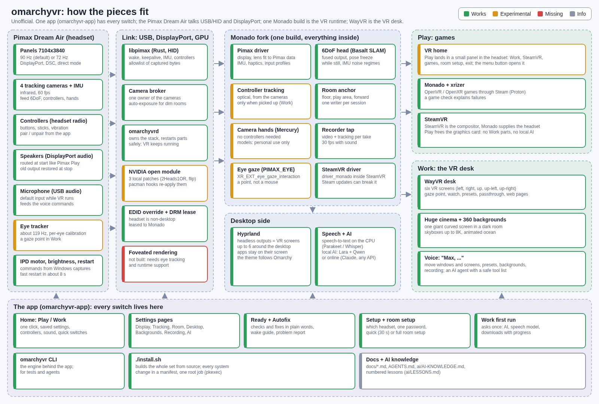

The diagram as a page: [docs/diagram/architecture.html](docs/diagram/architecture.html). In words: [docs/ARCHITECTURE.md](docs/ARCHITECTURE.md).

## The app

| | |
|---|---|
| 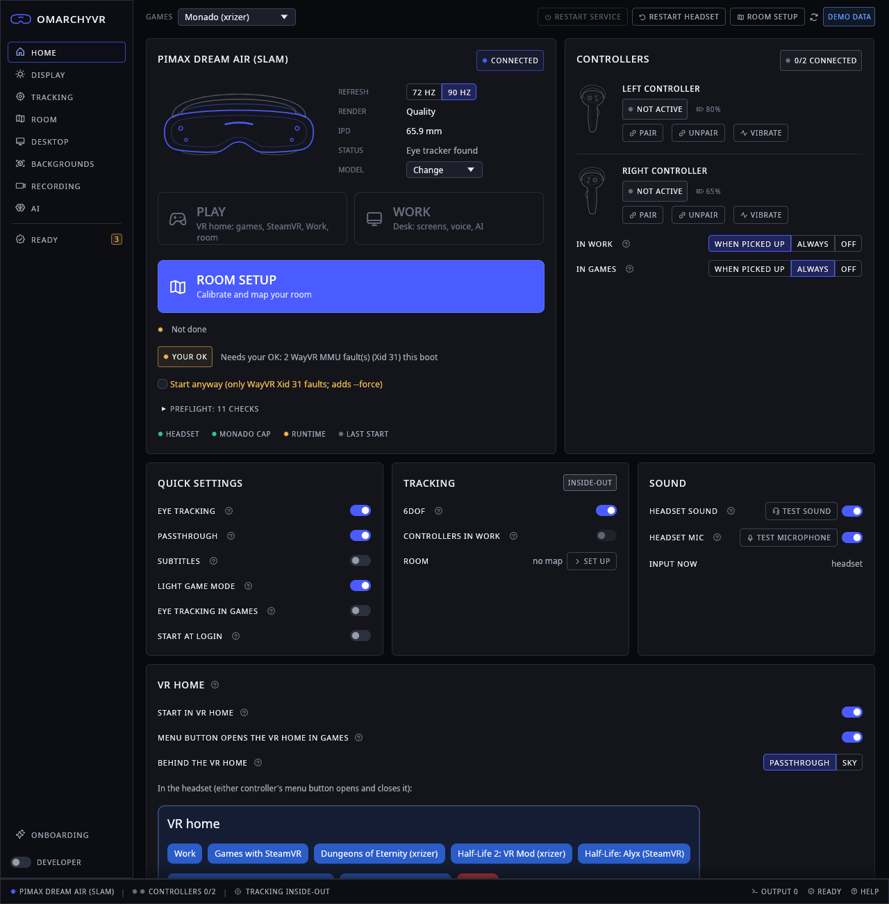 | 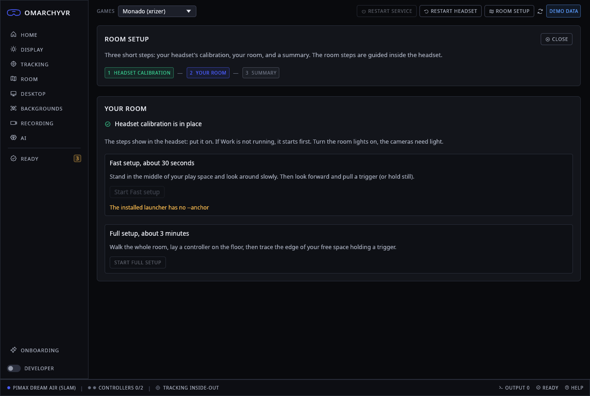 |
| 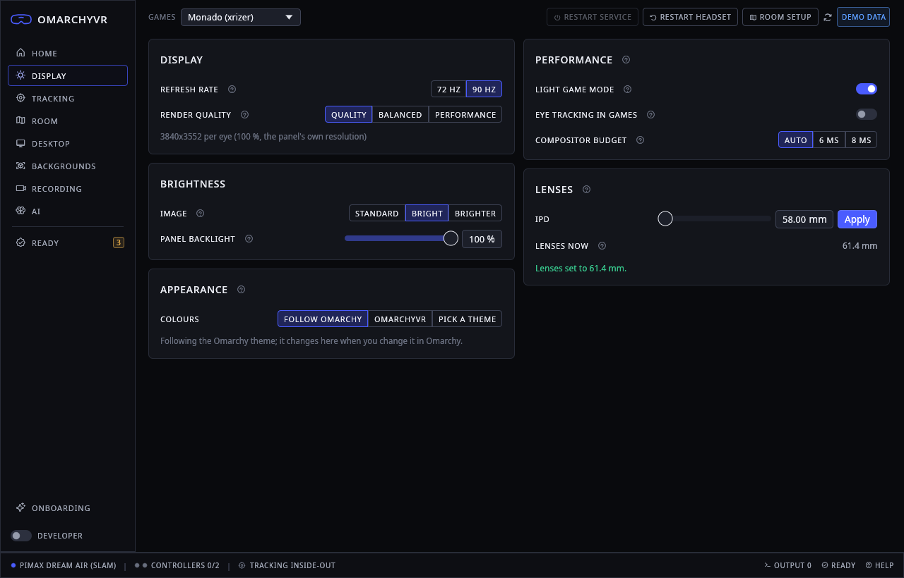 | 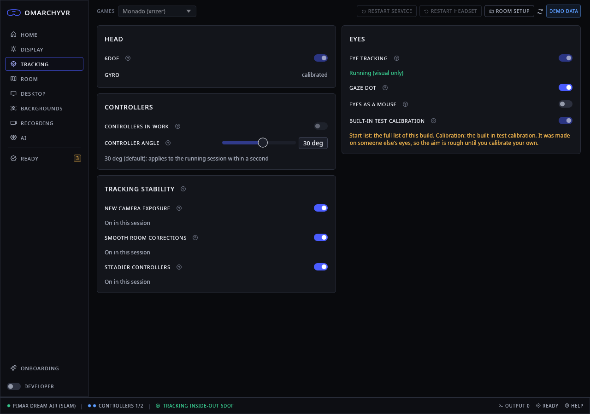 |
| 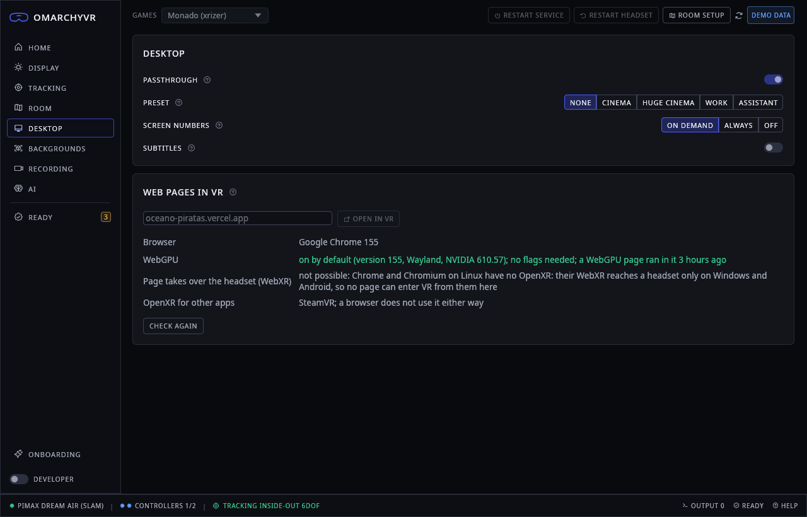 | 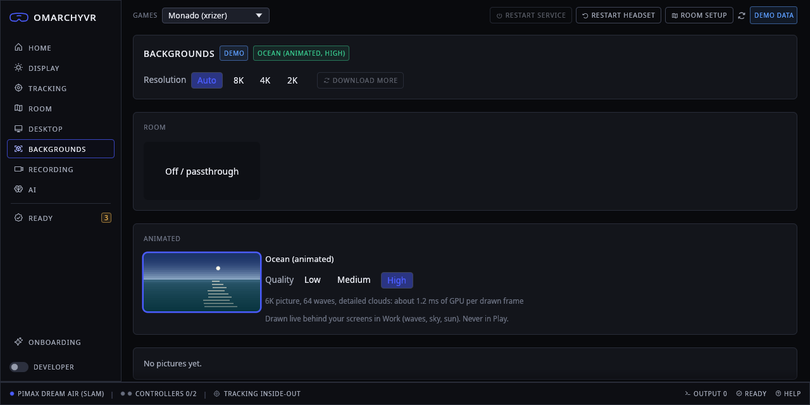 |
| 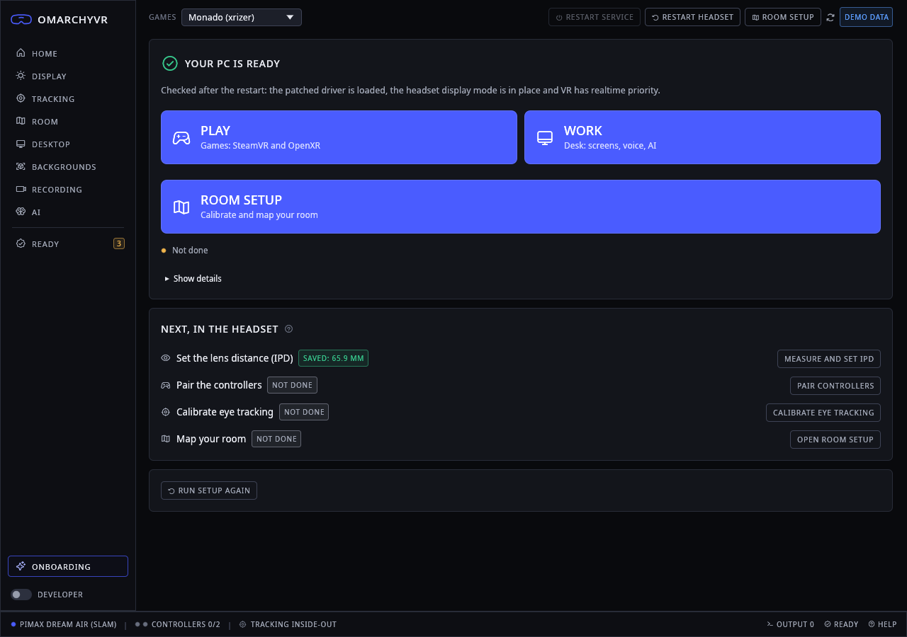 | 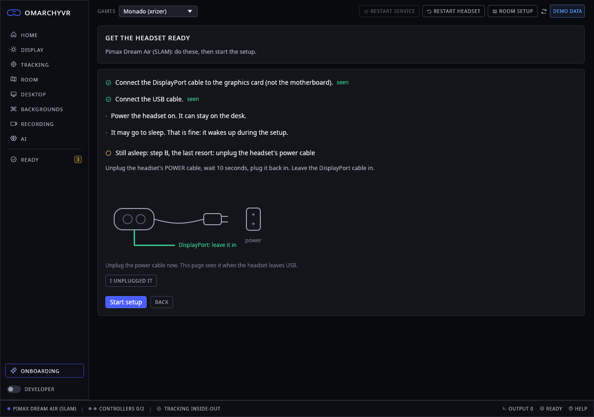 |
| 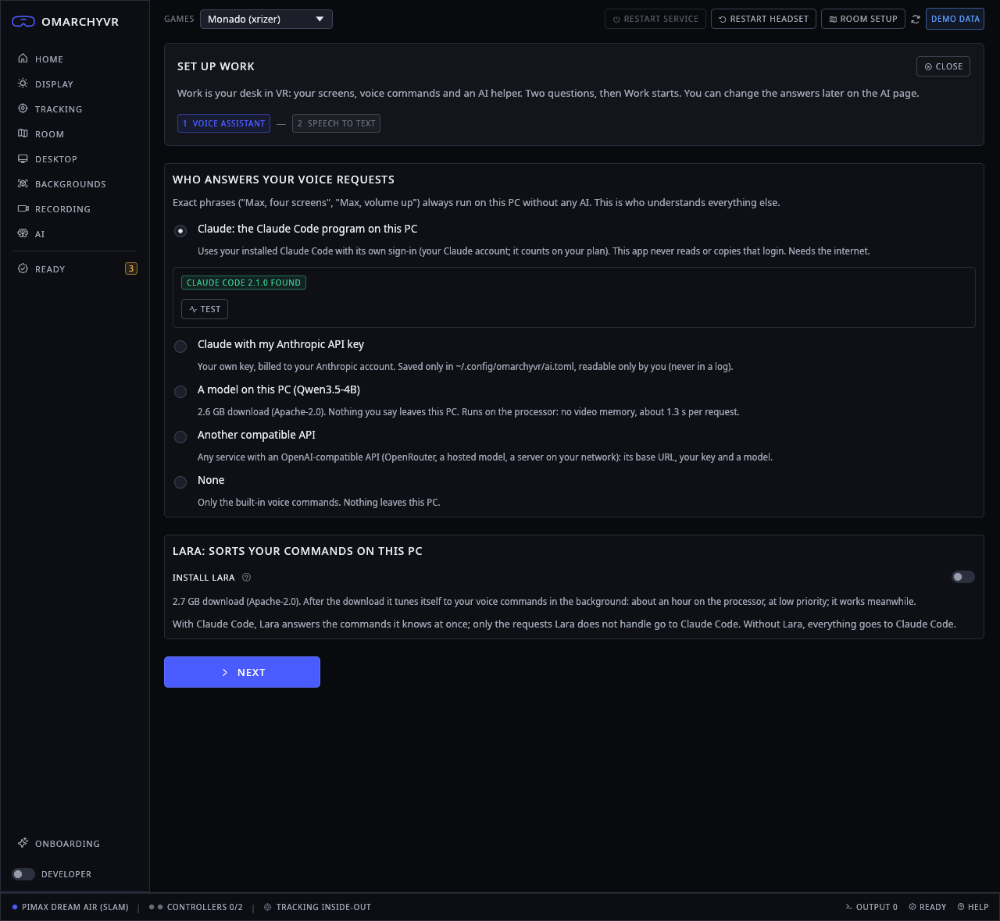 | 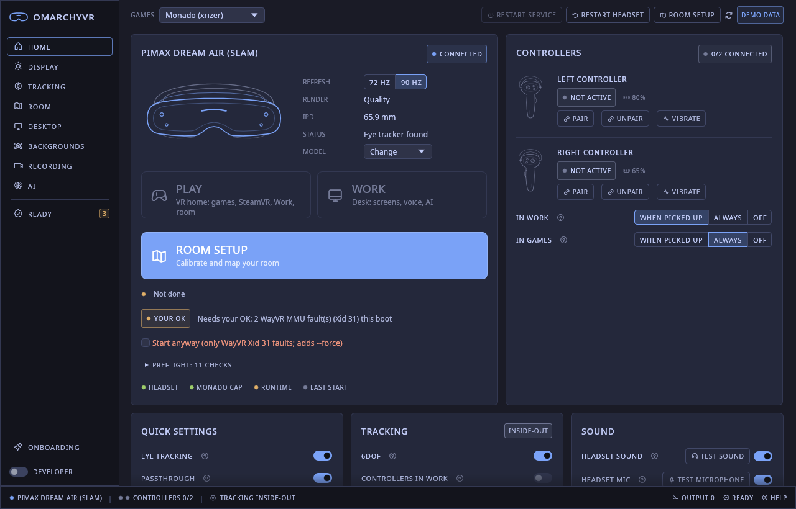 |

All pages (demo data, `omarchyvr-app --screenshots DIR`): [docs/gui](docs/gui), page by page in [docs/GUI.md](docs/GUI.md).

## Our machine

Everything is built and tested on one PC with one headset. Nothing is tested on other hardware yet.

| Part | Ours |
|---|---|
| Distro | Omarchy (Arch based) |
| Kernel | 7.2.5-3-omarchy |
| Compositor | Hyprland 0.56.2 (Lua config) |
| CPU | Intel Core i9-14900KF |
| RAM | 64 GB |
| GPU | NVIDIA GeForce RTX 4090 |
| NVIDIA driver | `nvidia-open-dkms` 610.57.04 with our three patches |
| Headset | Pimax Dream Air (SLAM edition) on DisplayPort, with its two controllers |
| SteamVR | 1789498647 (`bin/version.txt`) |
| Windows | dual boot, used only for the USB captures |

## What comes next

- **More testers and hardware.** Other RTX cards, other NVIDIA versions (each needs the patches checked), AMD and Intel
  (no NVIDIA patch needed, but untested). The status stays "one tested setup" until then.
- **NVIDIA upstream.** Send the 2Heads1OR fixes to NVIDIA so the patches and hooks can go away.
- **Packages instead of a source build.** Arch packages (`monado-pimax`, `wayvr-pimax`, `omarchyvr`) in an own
  repository and the AUR, then ask Omarchy for an optional menu entry ([docs/ROADMAP-OMARCHY.md](docs/ROADMAP-OMARCHY.md)).
- **In-headset tests** of the VR home and the SteamVR path, and a game compatibility list.
- **Better tracking**: controller tracking through occlusion, fewer 6DoF losses in fast turns.
- **Eye tracking** with final accuracy, then **foveated rendering**.
- **Safety**: the HID allowlist enforced on every write path ([docs/plans/WEEK1-SAFETY.md](docs/plans/WEEK1-SAFETY.md)).
- **Open source plan**: [docs/OPEN-SOURCE-PLAN.md](docs/OPEN-SOURCE-PLAN.md).

## Known problems

- **Updates outside our control** can break VR overnight: Steam / SteamVR, a new NVIDIA release, Hyprland. The app's
  Ready check, game check and Autofix find the usual causes; a real fix still needs a new build from us.
- **NVIDIA**: the picture needs the patched module; any untested driver runs unpatched (left half in both eyes).
- **Controller tracking** loses controllers that leave the cameras' view.
- **Eye tracking**: the eye tracker's cold-start data is not in the public tree; accuracy is not final.
- **Packaging**: `./install.sh` builds from source; the PKGBUILD and AppImage are drafts.
- **Hand models**: the Mercury models have no licence; they are fetched only when you ask, for personal use.
- **Security**: known open issues are in [docs/SECURITY-STATUS.md](docs/SECURITY-STATUS.md).

## Docs

| File | What |
|---|---|
| [docs/INSTALL.md](docs/INSTALL.md) | Install steps, what the password changes, NVIDIA policy |
| [docs/GUI.md](docs/GUI.md) | The app, page by page |
| [docs/PLAY.md](docs/PLAY.md), [docs/VR-HOME.md](docs/VR-HOME.md), [docs/GAME-MODE.md](docs/GAME-MODE.md) | Play, the VR home, the graphics card for games |
| [docs/STEAMVR.md](docs/STEAMVR.md), [docs/GAMES-CHECK.md](docs/GAMES-CHECK.md) | SteamVR, the games check |
| [docs/SCREENS.md](docs/SCREENS.md), [docs/CINEMA.md](docs/CINEMA.md), [docs/BACKGROUNDS.md](docs/BACKGROUNDS.md) | Work: VR screens, huge cinema, backgrounds |
| [docs/VOICE.md](docs/VOICE.md), [docs/AI.md](docs/AI.md), [docs/WORK-FIRST-RUN.md](docs/WORK-FIRST-RUN.md) | Voice, the AI agent, the Work first run |
| [docs/ROOM-SETUP.md](docs/ROOM-SETUP.md), [docs/TRACKING-STABILITY.md](docs/TRACKING-STABILITY.md), [docs/AUTO-EXPOSURE.md](docs/AUTO-EXPOSURE.md) | Room, tracking, camera exposure |
| [docs/CONTROLLERS-INHAND.md](docs/CONTROLLERS-INHAND.md), [docs/HANDS.md](docs/HANDS.md), [docs/EYE.md](docs/EYE.md) | Controllers, camera hands, eye tracking |
| [docs/AUDIO.md](docs/AUDIO.md), [docs/RECORD.md](docs/RECORD.md), [docs/RENDER-QUALITY.md](docs/RENDER-QUALITY.md) | Sound, recording, quality presets |
| [docs/HEADSET-COMMANDS.md](docs/HEADSET-COMMANDS.md), [linux/DISPLAY.md](linux/DISPLAY.md), [patches/nvidia](patches/nvidia/README.md) | Headset commands, display bring-up, NVIDIA patches |
| [docs/ARCHITECTURE.md](docs/ARCHITECTURE.md), [docs/OMARCHYVRD.md](docs/OMARCHYVRD.md), [docs/NAMES.md](docs/NAMES.md) | How the stack is built, the daemon, the names |
| [docs/LESSONS.md](docs/LESSONS.md), [docs/MANUAL-STEPS.md](docs/MANUAL-STEPS.md) | Pitfalls we hit, manual steps the app took over |
| [docs/ROADMAP-OMARCHY.md](docs/ROADMAP-OMARCHY.md), [docs/WINDOWS-CAPTURE-PLAN.md](docs/WINDOWS-CAPTURE-PLAN.md) | Roadmap, next Windows captures |
| [analysis/](analysis/) | Findings, decoders, research, Windows capture analysis |

## Safety

- Only bytes captured from Pimax Play on Windows are meant to be sent (the HID allowlist,
  `rust/pimax-device/devices/<id>/device.toml`). It is not yet applied on every write path; see [docs/SECURITY-STATUS.md](docs/SECURITY-STATUS.md).
- No firmware flashing. No forced display hotplug. A live VR session is never killed; installs happen between sessions.
- Serials, captures and calibration of a headset stay out of the public repo. The public export is allow-list based (`public-manifest.txt`).

## Report a bug

Open a GitHub issue and attach the report from the app: **Report a problem** writes
`~/.local/state/omarchyvr/reports/omarchyvr-report-<time>.tar.gz` (summary, checks, logs; text goes through a redactor).
It stays on your PC until you share it, so read it first. Security problems: see [SECURITY.md](SECURITY.md), not a public issue.

## Credits and licences

- [Monado](https://monado.freedesktop.org/) (BSL-1.0): our fork ([laughtt/monado](https://github.com/laughtt/monado), branch `omarchyvr`) carries the Pimax driver.
- [WayVR](https://github.com/wlx-team/wayvr) (GPL-3.0): our fork ([laughtt/wayvr](https://github.com/laughtt/wayvr), branch `omarchyvr`) adds gaze and VR screens.
- [xrizer](https://github.com/Supreeeme/xrizer): OpenVR on top of OpenXR.
- [Basalt](https://gitlab.freedesktop.org/mateosss/basalt) visual-inertial SLAM, via Monado.
- Mercury hand tracking (Monado): models have no licence, personal use only, not redistributed.
- Speech and language models keep their own licences and are downloaded on first use.
- Our code is `MIT OR Apache-2.0` ([LICENSE-MIT](LICENSE-MIT), [LICENSE-APACHE](LICENSE-APACHE)). Docs and data are CC-BY-4.0 ([LICENSE-CC-BY-4.0](LICENSE-CC-BY-4.0)). Third-party parts: [THIRD-PARTY.md](THIRD-PARTY.md).

## For developers

Monado and WayVR are git submodules under `forks/` (branch `omarchyvr`); clone with `--recursive`
(an existing clone: `git submodule update --init --recursive`). Enable the leak guard once per clone:
`git config core.hooksPath tools/git-hooks`. The Rust workspace is in `rust/` (`cargo test` there). Build from a clean
checkout of committed HEAD; the Monado build must keep its feature markers (list in [ai/CLAUDE.md](ai/CLAUDE.md)).
See [CONTRIBUTING.md](CONTRIBUTING.md) and [docs/INVENTORY.md](docs/INVENTORY.md).

AI agents: start with [AGENTS.md](AGENTS.md); the binding rules are in [ai/CLAUDE.md](ai/CLAUDE.md).
