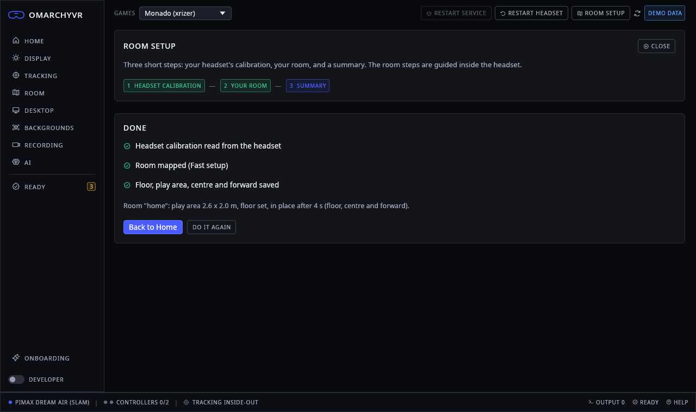
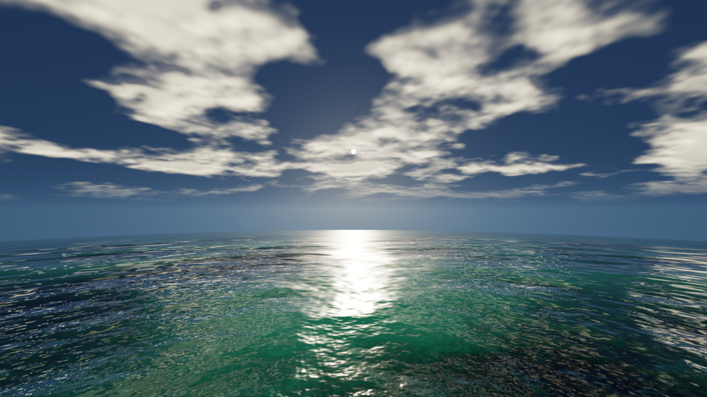

<h1 align="center">omarchyvr</h1>

<p align="center"><b>Pimax Dream Air on Linux. One app, one click.</b></p>

<p align="center">
  <a href="https://ko-fi.com/josemauriciocarpioherrera">Ko-fi</a> ·
  <a href="https://x.com/carpio_her8717">X</a>
</p>

<p align="center"></p>

## About

Pimax only supports Windows. We wanted our Dream Air on Omarchy, so we recorded what Pimax Play sends to the headset
over USB, figured out the rest, and built the Linux side ourselves.

You get one app. **Play** starts SteamVR and your VR games. **Work** puts your Hyprland desktop around you in the
headset, on up to six screens, with voice commands. Setup, room setup, settings and fixes all happen in the app.

This is an unofficial community project, not made or supported by Pimax or Omarchy. It is alpha and has been tested
on one PC.

## Install

Download `omarchyvr-<version>-x86_64.tar.zst` from the
[latest release](https://github.com/laughtt/omarchyvr/releases/latest), then:

```
tar --zstd -xf omarchyvr-*-x86_64.tar.zst
cd omarchyvr-*/ && ./install.sh
```

Nothing is compiled: the release is a finished build, about a 170 MB download. `./install.sh` checks the files,
installs them for your user and opens the app. The app then sets up the PC with **one password**, asks for a restart if
needed, and you press Play.

Want to build it yourself? `git clone --recursive https://github.com/laughtt/omarchyvr.git`, then `./install.sh` in the
clone builds everything from source.

The setup changes system files: it patches the NVIDIA driver, adds a display override to the boot image, installs a
udev rule and gives Monado realtime priority. Take a snapper snapshot first. Each change is listed in
[docs/INSTALL.md](docs/INSTALL.md).

<p align="center"></p>

## Compatibility

| | Status | Notes |
|---|:-:|---|
| Pimax Dream Air | ✓ | the only headset we have |
| Other Pimax headsets | ✗ | detected, not supported |
| Omarchy / Arch + Hyprland | ✓ | other Arch setups untested |
| NVIDIA RTX, driver 610.57.04 | ✓ | tested on an RTX 4090 |
| NVIDIA, other driver versions | ? | runs unpatched: both eyes show the left half |
| AMD / Intel | ? | no patch needed, never tried |
| SteamVR games | ✓ | Steam updates can break it |
| OpenVR / OpenXR games (Monado + xrizer) | ✓ | |

Our PC: Omarchy, kernel 7.2.5, Hyprland 0.56, i9-14900KF, 64 GB, RTX 4090 with `nvidia-open-dkms` 610.57.04.

## Features

| Feature | State |
|---|---|
| Display | 7104x3840 at 90 Hz (72 Hz too), lens correction from Pimax's own data |
| Tracking | 6DoF head tracking from the headset cameras; loses it in very fast turns |
| Controllers | buttons, sticks, vibration, pairing; optical tracking is rough |
| Room | quick (30 s) or full room setup, SteamVR boundary |
| Sound | headset speakers and microphone |
| Work | six VR screens, huge cinema, 360° backgrounds, passthrough |
| Voice | "Max, ..." commands, speech-to-text on the CPU, optional AI |
| Recording | video and tracking, 30 fps with sound |
| Eye tracking | experimental, used as a gaze point |
| Camera hands | experimental, no controllers needed |
| Foveated rendering | not yet |

<table>
  <tr>
    <td valign="top"></td>
    <td valign="top"></td>
  </tr>
  <tr>
    <td valign="top"></td>
    <td valign="top"></td>
  </tr>
</table>

## How it works

The Dream Air is dead on Linux out of the box. Four things had to be solved.

**Talking to the headset.** We captured Pimax Play on Windows with USBPcap and decoded the protocol. Everything that
turns the headset on goes through one HID channel. Our Rust library sends only bytes we saw in those captures: wake,
keepalive, panel on, IMU, controllers, IPD motor, restart. Nothing is ever flashed.

**Getting a picture.** The headset's EDID is broken for Linux, so we load our own at boot. It fixes the colour depth,
enables DSC and marks the headset as a VR display, so Hyprland leaves it alone and Monado can drive it directly.
7104x3840 needs NVIDIA to merge two display heads into one output, and the open driver has bugs there: both eyes
showed the left half, and the display could freeze. We carry three small kernel patches for that
([patches/nvidia](patches/nvidia/README.md)). Pacman hooks put them back after every driver update.

**Tracking and the runtime.** A Pimax driver in our Monado fork handles the display, lens correction, IMU, head
tracking (Basalt SLAM on the headset cameras), controllers, eye tracking and hands. Everything is in one build.

**Sound, desk and games.** The speakers get sound over DisplayPort, so the app switches the audio output when VR
starts. Work runs on our WayVR fork. Games run through SteamVR or Monado with xrizer.

<p align="center"></p>

## Known issues

- A Steam, NVIDIA or Hyprland update can break VR overnight. The app's Ready page finds most causes, but some
  fixes need a new build from us.
- Only one NVIDIA driver version is tested.
- Controllers lose tracking when they leave the cameras' view.
- Eye tracking accuracy is not final.
- The hand-tracking models have no licence, so they are only downloaded when you ask for them.

## Roadmap

- More testers, more GPUs, more driver versions
- Send the NVIDIA fixes upstream so the patches can go away
- Arch packages instead of a source build, then an optional Omarchy entry
- Better controller tracking, then eye tracking and foveated rendering

## Getting help

In the app, **Report a problem** saves a report to `~/.local/state/omarchyvr/reports/`. Logs go through a redactor,
but read the file before you attach it to an issue.

Everything we learned is written down for AI assistants: give yours [AGENTS.md](AGENTS.md) and the `ai/` folder
together with your report, and it can usually find the cause. More docs are in [docs/](docs/).

Security problems: please follow [SECURITY.md](SECURITY.md) instead of opening an issue.

## Credits

Built on [Monado](https://monado.freedesktop.org/), [WayVR](https://github.com/wlx-team/wayvr),
[xrizer](https://github.com/Supreeeme/xrizer) and Basalt. Our forks of Monado and WayVR are in `forks/`.

"Pimax" and "Dream Air" are trademarks of Pimax. No warranty: use at your own risk. Code is MIT or Apache-2.0, docs
are CC-BY-4.0, third-party parts are listed in [THIRD-PARTY.md](THIRD-PARTY.md). Contributions are welcome, see
[CONTRIBUTING.md](CONTRIBUTING.md).
