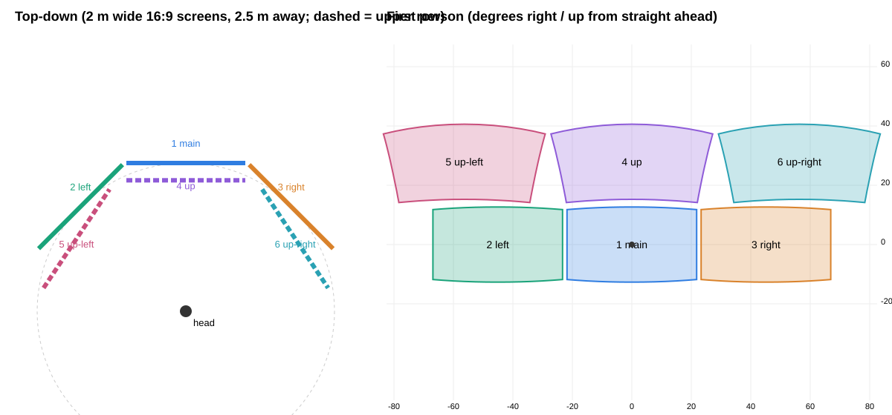

# VR screens (Work / desk mode)

In Work mode (the WayVR desk), you can have up to **six VR screens** (user decision 2026-10-16):
- the desktop in the centre;
- one screen to its left, one to its right and one above it;
- one above the left screen (**up-left**) and one above the right screen (**up-right**).

```
 up-left   up    up-right
  left    main    right
```
The screens are filled in this order: left, right, up, up-left, up-right.

## Screen numbers (single source of truth)
Every VR screen has a fixed number. It is the same everywhere: the number badge WayVR draws on each screen,
`omarchyvr desk screens show N` (the first N screens in this order), and voice ("screen 3"):

| number | slot | output |
|---|---|---|
| 1 | main (centre) | the desktop output (e.g. `SUNSHINE`) |
| 2 | left | `PIMAX-LEFT` |
| 3 | right | `PIMAX-RIGHT` |
| 4 | up | `PIMAX-UP` |
| 5 | up-left | `PIMAX-UPLEFT` |
| 6 | up-right | `PIMAX-UPRIGHT` |

- A number belongs to its slot, not to "the Nth screen shown": screen 4 is always the up screen, also while screens
  2 and 3 are hidden.
- The numbers are not Hyprland workspace numbers (the left screen may show workspace 11). "Workspace N" in voice stays
  the Hyprland workspace.
- "Here" means the focused screen (the screen you are looking at only with "Eyes as a mouse" on, docs/EYE.md).
- The badges: `wayvrctl screen-numbers show|hide|flash [N]|off|ondemand|always` (WayVR 29c5a2c). Voice flashes them
  on "Max" alone and on screen commands, and flashes the target screen N after a move (`windows::badges`); voice also
  has "show / hide / always show screen numbers". A missing command (older WayVR) is ignored.
- Code: `SCREEN_ORDER` in `rust/omarchyvr-voice/src/windows.rs`, the same order as `Slot` in `rust/omarchyvr-tools/src/vr/screens.rs`.

Each extra screen is a real Hyprland desktop. You can open apps on it, move apps to it, and focus it.

## In the app
**Desktop > Screens** (developer mode): choose 1 to 6 screens. The default is 4 (the desktop + left, right and up).
- The choice is saved in `~/.config/omarchyvr/gui-state.toml` as `screens = N`.
- It reaches the Work start as `omarchyvr desk start --screens N`. The flag is only written when N is not 4, because 4 is
  the launcher's default.
- The start records it in `start-argv.txt`, so restarts and omarchyvrd keep it. The app also reads `--screens` back from
  the record, so a change made during the session (see "Showing more screens") becomes the app's setting.

Under the selector, a readiness line shows the state of the screens:
- before the session: "VR screens: 4 at the next Work start";
- during the session: the virtual outputs that exist, for example "VR screens: 4 (SUNSHINE in the centre; virtual
  outputs left PIMAX-LEFT, right PIMAX-RIGHT, up PIMAX-UP)" (up-left is `PIMAX-UPLEFT`, up-right `PIMAX-UPRIGHT`);
- if creating them failed: the reason, shown in yellow. The session still starts, with one screen.

## How it works
1. **Displays before VR.** The Work start (`desk start`, not Play or game mode) creates the extra screens **before
   Monado and WayVR start**. Each one is a Hyprland *headless* output, made with runtime calls only (`~/.config/hypr` is
   never edited):
   ```
   hyprctl eval 'hl.monitor({ output = "PIMAX-LEFT", mode = "1920x1080@60", position = "-1920x0", scale = 1 })'
   hyprctl output create headless PIMAX-LEFT
   ```
   - Each output has the main desktop output's size.
   - The outputs sit left of, right of and above the main output (up-left at (-W, -H), up-right at (W, -H)), so Hyprland's own "focus left/right/up" crosses to
     them too.
   - `desk stop` removes them once Monado has exited.
   - Outputs are **never created or removed while a monado-service runs**, because that can disturb the leased DP-1.
     The code refuses in that case.
   - Between the watchdog's stop and its restart, the outputs are kept.
2. **Idempotent.**
   - Outputs that already exist with the right size are kept.
   - Stale `PIMAX-*` outputs, from a crashed session or with a different count or size, are removed first.
   - Missing outputs are created.
   - Any failure is written to `<session dir>/screens.txt` and shown in the app; the session goes on with the
     screens that exist.
3. **Layout in VR.** WayVR names each screen after its output.
   - `wayvrctl desk-screens` (WayVR, eye-gaze branch) places the screens in the **default layout** (next section):
     two rows of three around the head, none overlapping from the head. A screen already shown and not re-placed
     stays where you put it; a newly shown one takes its slot and moves aside just enough if that slot is taken.
   - The same command also shows or hides each screen.
   - Presets call it with `--place --hide-others`. In that case WayVR app panels are not used.
4. **Screens on demand.** `omarchyvr desk screens watch` is a small process of the session (omarchyvrd leaf component
   `screens`). It follows Hyprland's event socket.
   - A VR screen is **shown while its workspace has an app, or while it has the focus**. Otherwise it is hidden, but it
     keeps running.
   - Presets set a limit, kept in `$XDG_RUNTIME_DIR/omarchyvr-screens.state`:

     | preset | screens shown |
     |---|---|
     | cinema, work-1 | the main screen only |
     | work-3 | main + left + right (shown even when empty) |
     | assistant, none | every screen, on demand |

   - The **focused** screen is always shown, even over the limit: an app that opens there, or "go to the left
     screen", never lands on a screen you cannot see.
   - Voice screen commands lift the limit.
   - If the watcher fails, the screens just stay as they are, and omarchyvrd restarts it.
5. **Modes never close apps** (user report 2026-10-15). A mode (cinema, work-3, work-1, assistant) only changes how
   many screens show and where they are. It reads Hyprland and tells WayVR which screens to show; it never closes,
   kills or moves an app. A screen it hides keeps its apps, and the toast names them: "Cinema mode. Still open on
   hidden screens: left (google-chrome), right (pimax). Say "go to the left screen"". The next mode with more
   screens (work-3, assistant) shows them again. `--hide-others` only hides other desktop captures (a mirrored
   output), never a WayVR app window or panel.
   - What happened in the report: "put everything in its own window" had put Chrome on the left screen and the
     Pimax app on the right one; "put everything in cinema mode" then hid both screens (cinema shows one), with no
     word about it, so the apps looked closed. Hyprland still had all three apps.

## The default layout and screen placement (user decisions 2026-10-17)

"Set a default position for the screens, 6 in total, that NEVER overlap each other from one perspective." And: a
command like "move this left" means "put THIS screen to the LEFT of the other one", seen from where the head is NOW;
no continuous checking, the placement is computed once per command.



**The default layout** (Work start, presets, Reset screens; WayVR `windowing/viewlayout.rs`, `default_layout`):
```
 5 up-left   4 up   6 up-right      <- the upper row: a band of elevation above the lower one
 2 left     1 main  3 right
```
Nothing in it is a fixed angle: everything comes from each screen's size and distance.
- **Lower row:** main straight ahead of the head (level) at the distance (`-d`, 2.5 m), `-w` wide (2 m), facing you.
  Left and right are turned about the head (the world's up axis) by the smallest angle that leaves **1.5 deg**
  between their edges and main's, as seen from the head (`MARGIN`; more if `--gap` metres at that distance is more).
- **Upper row:** each screen is turned up by the smallest angle that puts its LOWEST point 1.5 deg above the
  HIGHEST point of the lower row. Rows are then bands of elevation, so no turn along a row can make the rows overlap.
  Up is above main; up-left and up-right start at the azimuth of left and right and are pushed further out only as
  far as needed, because the top row sits higher, where the same width covers more azimuth.
- Every screen faces the head and keeps the distance.

The numbers for six 2 m wide 16:9 screens 2.5 m away (from the test `default_layout_diagram`, which also writes the
picture above):

| screen | yaw (+ = left) | pitch | size |
|---|---|---|---|
| 1 main | 0 | 0 | 2.00 x 1.125 m |
| 2 left | +45.1 deg | 0 | same |
| 3 right | -45.1 deg | 0 | same |
| 4 up | 0 | +27.9 deg | same |
| 5 up-left | +56.3 deg | +27.9 deg | same |
| 6 up-right | -56.3 deg | +27.9 deg | same |

(45.1 = 2 x atan(1 / 2.5) + 1.5: half widths of both screens plus the margin.)

**Do two screens overlap from here?** (`viewlayout::overlap`) Both flat screens are projected through the eye onto
the plane facing the mean of their two directions (a central projection keeps straight edges straight, so each one is
a convex quadrilateral), and they overlap unless an edge normal separates them by more than the margin (separating axis
test). This is exact for flat screens; the 1.5 deg margin covers curved ones and the eye moving a few cm in the head.

**Placing a screen** (`viewlayout::place`), once per command, from the head pose at that moment:
- **left / right / up / down**: the screen takes the pose of its reference screen and is turned about the head by the
  smallest angle that leaves the margin between them. The reference is the one named ("put screen 2 above screen 1",
  `--of`), else its nearest neighbour on that side in the same row (or column): "move this left" moves it one place
  to the left. With no neighbour on that side it turns one own width (height) that way. Above/below stop at 75 deg
  elevation; with no room left there, the reference makes room instead.
- **front** ("bring this screen here"): straight ahead of where you look now, at its own distance.
- **swap** (`wayvrctl screen-place A swap --of B`): the two change places.
- **closer / farther / bigger / smaller** (`screen-nudge`) change the screen as before.
- Then **the others make room** (`viewlayout::resolve`): the moved screen (and its reference) stay fixed; every screen
  that now overlaps another is turned along the arc around the head, away from the screen it hit, by the smallest
  angle that frees it from the screens already settled. Sideways first: an up/down push counts 2.5 times its angle, so
  rows stay rows. A screen that was clear of another only has to stay half the margin away from it, so pushing a
  screen along its row never counts as hitting the row above. The result is world-locked and saved, like a grab.
- **Reset screens** (double-click B, `wayvrctl reset-screens`, the app's Reset screens) puts every shown screen in the
  default layout from where your head is now (slots by their number badge or `PIMAX-*` name; any other screen beside
  them).
- Never continuous: nothing is checked per frame, and a screen you hold or move by hand is never pushed.

Voice (omarchyvr-voice `windows.rs`, `wayvrctl screen-place NAME left|right|up|down|front|swap [--of OTHER]`):

| say | does |
|---|---|
| move this left / right / up / down | the screen goes to the left of its left neighbour (one place over), and so on |
| put screen 2 above screen 1, move screen 5 to the left of screen 4, put screen 3 next to screen 2 | beside that screen ("next to" = right of it) |
| bring this screen here | in front of you |
| move it in front of me | all screens: Reset screens |

An older WayVR without `screen-place` gets the old turn by a quarter of the width (`screen-nudge`).
Tests (WayVR, `windowing/viewlayout.rs`): overlap from a viewpoint, the default layout for eight sizes and distances
(1 m to 6 m wide, 1 m to 8 m away), "move left" with the neighbours making room, up/down/next to/front/swap, six
screens stacked on top of each other, the user walking 1.5 m, and 600 random commands with the head turning and moving
between them (never an overlap, nothing creeps when a command is repeated).

## Showing more screens during the session (voice)
WayVR learns the screens (Hyprland outputs) **when it starts**; it does not pick up an output created later (checked in
the code: `create_screens` runs once, in `OverlayWindowManager::new`; there is no hotplug handling). So nothing creates
an output live. A Work session has the screens that its start made, and the commands below show or hide those.
The voice process calls these; each prints ONE plain line for the headset toast and exits 0, or prints a plain error
and exits 1 (2 for a wrong argument):
```
omarchyvr desk screens show N      # N = 1..6: the main screen + the first N-1 of left, right, up, up-left, up-right
omarchyvr desk screens more K      # the screens shown now (counted like the watcher does) + K, capped at 6
omarchyvr desk screens add SLOT    # left | right | up | up-left | up-right: pin and show that one, raise the limit
omarchyvr desk screens hide 4,3    # (voice: "close / remove screen 4 and 3") those screens hide, even with apps; apps stay open
omarchyvr desk screens hide others # (voice: "close everything") only the main screen; no app closes
```
- `show N` pins those screens and sets the limit to N in `omarchyvr-screens.state`, then sends `desk-screens` to WayVR
  (a screen that was hidden is placed when it shows). N above 6 shows 6 and says "That's the most: 6 screens".
- If the session started with fewer screens, the missing ones cannot be made live. The line says it in plain words
  ("6 screens need Screens = 6 in the Pimax app and a Work restart. Showing 4 screens"), the screens that exist are
  shown (exit 0), and the recorded `--screens` in `start-argv.txt` is **raised** (never lowered) so a restart has
  them and the app's Screens setting follows.
- No Work session: "No Work session is running", exit 1, nothing written.
- They never close, kill or move an app, and never run a Hyprland dispatcher.
- A mode (preset) switch afterwards sets its own limit and pinned screens again.
- Voice phrases (done in `omarchyvr-voice`): "two more screens" = `more 2`, "four screens" = `show 4`, "a screen up
  there" = `add up`.

## Screen numbers (badges)
Every VR screen can show a number badge at its top centre (a rounded pill with a big digit and the slot name, e.g.
"3 RIGHT"), so you can say "Max, move the terminal from screen 2 to screen 4". The number belongs to the slot, the same
order as `omarchyvr desk screens show N`:

| number | 1 | 2 | 3 | 4 | 5 | 6 |
|---|---|---|---|---|---|---|
| slot | main | left | right | up | up-left | up-right |

- **Modes** (app: Desktop > Screen numbers; saved in `~/.config/omarchyvr/wayvr-desk.conf` as
  `screen_numbers = off|ondemand|always`, written by `desk start` into conf.d as `screen_numbers: on_demand|always|off`,
  so restarts keep it; a change applies at once to a running WayVR): **On demand** (default: shown about 5 s when a
  screen is shown or hidden, re-placed or moved, or flashed), **Always**, **Off**.
- **WayVR commands** (`wayvrctl screen-numbers ...`, for omarchyvr-voice): `show` (all badges ~5 s), `hide`,
  `flash` (same as show), `flash N` (show and highlight screen N: bigger and amber for ~2.5 s, the target of a voice
  command), and the mode words `off`, `ondemand`, `always`.
- The badges follow their screen when it moves or resizes. They are not pointable. Only shown screens get one.

## The layout inside a screen (user decisions 2026-10-15)
One screen = one Hyprland workspace. The screens watcher applies these rules whenever apps open or move (not only on
the voice command):
- **One app alone fills its screen** (tiled and maximized).
- **Apps of the same kind share a screen, tiled to fill it**: 2 Chromes = half and half, 3 terminals = three tiles.
  With more (5 terminals), they keep tiling on the same screen.
- **Apps of different kinds never share a screen.** An app that opens on, or is sent to, a screen holding another
  kind goes to the screen that already has its kind, else to the next free screen (left, right, up, main). The kind
  that was there first stays.
- **Kinds** are by app class: browser (chrome, chromium, firefox, ...), terminal (foot, alacritty, kitty, ghostty),
  the Pimax app, and every other class is a kind of its own.
- Without a free screen, the app stays and shares its screen, tiled (never sent to a workspace no screen shows).
- Only apps that arrive on a screen (open or move there) are acted on, so an app you float or resize by hand stays
  that way until something changes on its screen. When an app leaves, the one left fills the screen again.
- Not touched: hidden workspaces, pinned windows, a real fullscreen (a video), and helper dialogs (file pickers,
  password prompts: classes `xdg-desktop-portal*`, `polkit*`, `pinentry`, `gcr-prompter`, `zenity`, ...).
- At the watcher's start nothing moves: it notes where the apps are.
- In cinema or work-1, an app sent to its own screen lifts the screen limit, so it does not vanish.
- "Put everything back together" turns the sorting off (`sort = off` in the state file): the kinds share the main
  screen on purpose. "Put everything in its own window" turns it on again. A mode switch keeps the setting.
- Hyprland 0.56 dispatchers used: `hl.dsp.focus({ window = "address:..." })` then
  `hl.dsp.window.move({ workspace = "N", follow = false })` (the focused app follows its move; the focus comes back
  after moving others), `hl.dsp.window.float({ action = "unset", window = ... })` (tile; the desktop config opens
  every window floating) and `hl.dsp.window.fullscreen({ mode = "maximized", action = "set"|"unset", window = ... })`.
  The `float` action names (`set`/`unset`, like `fullscreen`) were not checked against the live compositor (a Work
  session was running); a failing step is logged in `screens.log` and nothing else changes.

## Voice ("Max, ...")
The words follow the user's decisions of 2026-10-15 (docs/VOICE-DECISIONS.md):
- a **window** is always a whole VR screen (its workspace);
- "this" or an app's name means **one app**;
- a **tab** is inside an app.

| say | does |
|---|---|
| new window / open a new window | focuses the **next free screen**, in the order left, right, up, up-left, up-right (the first whose workspace has no app), and shows it. If every screen has apps, you get an empty workspace on this screen. |
| move this left / right / up / down, move the screen left | places the **VR screen itself** (the focused one; the one you look at only with "Eyes as a mouse" on) beside its neighbour on that side, as seen from your head now; the others make room so none overlaps (`wayvrctl screen-place`, see "The default layout and screen placement") |
| put screen 2 above screen 1, move screen 5 to the left of screen 4, bring this screen here | the same placement beside the named screen, or in front of you |
| bring it closer / push it away | the screen a quarter of its distance closer or farther (0.4 to 8 m) |
| zoom in / zoom out, make the screen bigger / smaller | the screen 25 % bigger or smaller, in place |
| send this to the left screen, move this app to the right screen, send this to the main screen | sends the **focused app** to the screen on that side of its own screen. From the left screen, "right" is the main one. From the up screen, "down" is the main one. |
| go to the left screen / switch to the right screen / focus the main (middle) screen | focuses that screen |
| put everything in its own window / organize / separate everything | sorts the apps of the shown screens **by kind**: terminals together (tiled splits), the browser, the Pimax app, and each other app class on its own. The kind of the app you are using stays where it is; the other kinds go to the left, right and up screens. When the screens run out, a kind stays where it is. With one screen, a kind goes to the next unused workspace. Hidden workspaces are not touched. Turns the watcher's sorting on. |
| put everything back together / merge everything | every app on the left, right and up screens joins the main screen, tiled. The screens then hide by themselves, because they are empty. Turns the watcher's sorting off until the next "put everything in its own window". |
| move Chrome to screen 3, put all the terminals on the left screen, the newest terminal to screen 5 | the apps of that kind or name (class or title; "one"/"newest" = only the one used last) go to that screen; the focus stays |
| move the terminal from here to screen 4, move everything from screen 2 to screen 5 | the same, only the apps on the first screen ("here" = looked at / focused) |
| swap screens 1 and 2 | the apps of the two screens change places; the screens stay where they are |
| go to screen 3, what's on screen 3, make screen 2 bigger, open YouTube on screen 3 | focus, list, resize or move (bigger, smaller, closer, farther, left, right, up, down), open a site / URL / file / terminal there |
| save this layout (as coding), restore the (coding) layout | remembers which app is on which screen (`~/.local/state/omarchyvr/voice-layouts.json`); restore moves the open apps back, nothing opens or closes |
| list windows | the VR screens with their apps: "4 screens \| 1 Main: foot, firefox \| 2 Left: empty \| 3 Right: code \| 4 Up: empty \| not shown: 3 (steam)" |
| close window | closes the whole screen's apps. It asks "say yes" only when there are 2 or more apps; with one app it closes at once ("close this" = one app, at once). |
| close the other windows / only this window / one screen | **shows one screen only** (the work-1 preset). It never closes workspaces or apps. |

### What voice knows, and how a move is checked (2026-10-17)
The voice keeps the state simple (`rust/omarchyvr-voice/src/screenstate.rs`): per screen **number** 1-6 (found by the
output name: the main output, `PIMAX-LEFT`, `PIMAX-RIGHT`, `PIMAX-UP`, `PIMAX-UPLEFT`, `PIMAX-UPRIGHT`, never by
order) whether it **exists** in this session, whether VR **shows** it (the watcher's rule: main always; an extra one when
pinned, with apps or focused, within the mode's limit, never when hidden by voice), and the windows on it (address,
class, title). Windows on a workspace no screen shows are "off-screen". It is read fresh for every command from one
`hyprctl -j monitors` and one `hyprctl -j clients`; nothing is cached.

- A move ("all the terminals to screen 3", "chrome on 4", "move all the terminals") becomes a desired state (window ->
  screen); the moves are exactly the windows that are not there yet, each moved by its address.
- After the moves the state is read again. A window still not on its screen gets **one** more try, then a last read
  decides the answer: "Moved foot 'build' to screen 3 (right); 1 already there", or "Could not move foot 'build' to
  screen 3 (right), it is still on screen 1 (main)". "Already there" is said only when the fresh read shows it.
- A screen that does not exist (Screens = 6 in the app, but the session made 4 outputs) moves nothing: "There is no
  screen 5 (up-left) now: this Work session has 4 screens. Set Screens to 5 or more in the Pimax app and restart Work".
- A target screen that exists but is hidden shows first. "Open the browser (on screen 4)" also shows the screen the
  browser is on; a browser that no screen shows comes to the focused screen.
- The AI model gets the same state: every app as `on 3 right` (never a bare workspace number, which it read as a screen
  number), and a screens line `1 main shown [w2 foot] ; ... ; 5 up-left missing`.

The app has the same two buttons under **Screens**: **Put everything in its own window** and **Put everything back
together**. They are enabled while Work runs, and they run the same voice intent (`omarchyvr-voice do --no-wake ...`).

### What you see with "put everything in its own window"
The Work session starts with all apps stacked on the big main screen: for example two terminals, Chrome, the Pimax
app and Obsidian. You are typing in a terminal. After "Max, put everything in its own window":
- the two terminals stay on the main screen, side by side as tiled splits;
- Chrome appears on a new screen to the left;
- the Pimax app appears on a screen to the right;
- Obsidian (another kind) appears on a screen above.

Each new screen shows up because it now has an app. The terminal keeps the focus. The toast says "Organized:
terminals on the main screen, browser on the left screen, Pimax app on the right screen, obsidian on the up screen.
Say "put everything back together" to undo".

"Max, put everything back together" moves Chrome, the Pimax app and Obsidian back onto the main screen, tiled with the
terminals. The left, right and up screens become empty and hide.

Typing ("type ...", "press enter") always goes to the **focused app**. It uses one persistent virtual keyboard per
voice process (see [VOICE.md](VOICE.md)).

## CLI (for agents and tests)
```
omarchyvr desk start --screens 1|2|3|4|5|6     # default 4
omarchyvr desk screens status                  # last start's report, the outputs, what VR shows
omarchyvr desk screens sync [--dry-run]        # send the visibility to WayVR once
omarchyvr desk screens create|remove [--screens N] [--dry-run]   # refused while a monado-service runs
omarchyvr desk screens show N | more K | add SLOT   # voice: one plain line, exit 0 / 1 (see above)
omarchyvr desk screens watch                   # the session's watcher (started by desk start)
wayvrctl desk-screens [--place] [--hide-others] [-w 2] [-d 2.5] [-c 0] [--gap 0.05] main=SUNSHINE left=PIMAX-LEFT right=PIMAX-RIGHT:hide up=PIMAX-UP:hide up-left=PIMAX-UPLEFT up-right=PIMAX-UPRIGHT
wayvrctl screen-place PIMAX-UP left [--of SUNSHINE]   # left|right|up|down|front|swap: placed once from the head now; the others make room
wayvrctl reset-screens                        # every shown screen back in the default layout
```
Tests never reach the real compositor:
- `PIMAX_HYPRCTL` points the launcher at a fake `hyprctl`;
- the CLI tests put a fake one first on `PATH`.

## Limits
- A `hyprctl reload` drops the runtime monitor rules. The outputs stay, but Hyprland may place them elsewhere. Only
  "focus left/right" across monitors changes; what VR shows does not.
- Monitor rules added with `hyprctl eval` stay in Hyprland's memory until the next reload. They only match the
  `PIMAX-*` names.
- Code:
  - `rust/omarchyvr-tools/src/vr/screens.rs` (outputs, state, watcher);
  - `rust/omarchyvr-voice/src/windows.rs` (voice);
  - `rust/omarchyvr-gui-core/src/screens.rs` and `rust/omarchyvr-app/src/pages/screens.rs` (app);
  - WayVR `desk_screens`, `screen_place`, `screen_nudge` in `wayvr/src/ipc/events.rs`, the layout maths in
    `wayvr/src/windowing/viewlayout.rs`, Reset screens in `windowing/manager.rs` (`reset_screens`).

## Apps do not hop screens by themselves (2026-10-17)
The default layout never overlaps and nothing is re-sorted while you work: the watcher's `sort` is OFF at every
session start (`sort = off` in the state file) unless the app switch "Auto-arrange apps" (Desktop page, Next desk
start; `auto_arrange` in `wayvr-desk.conf`, default off) is on. Apps change screens only on an explicit command ("move
left", "put everything in its own window", which turns the sorting on until "put everything back together"). Modes
(`desk preset NAME`, voice "cinema") show and hide screens but do not re-place screens that are already placed; only
`desk preset NAME --replace` (and the start) re-places them.
